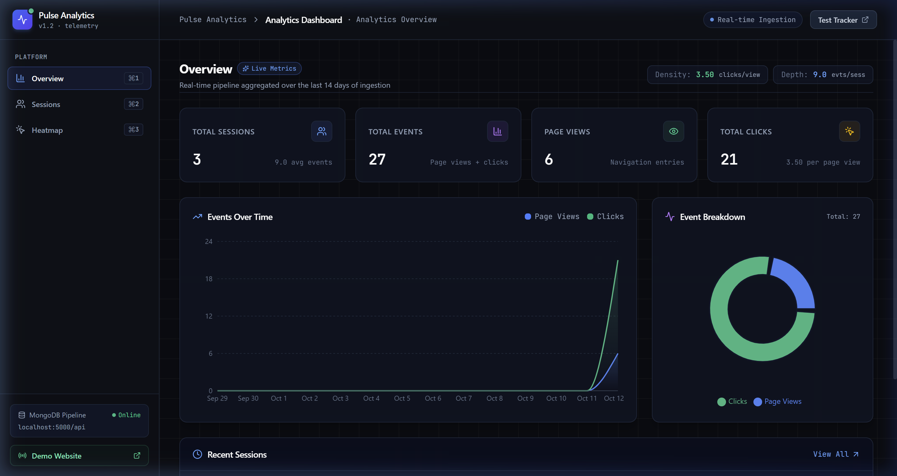
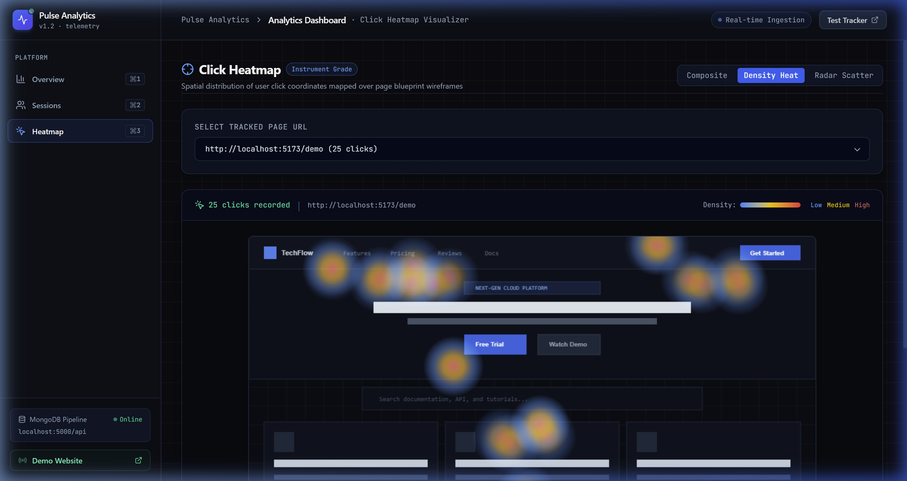
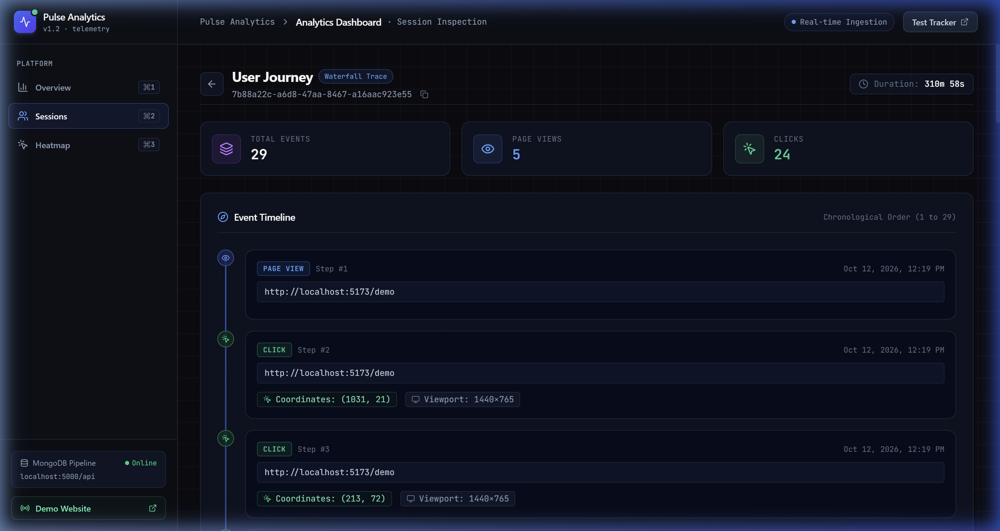
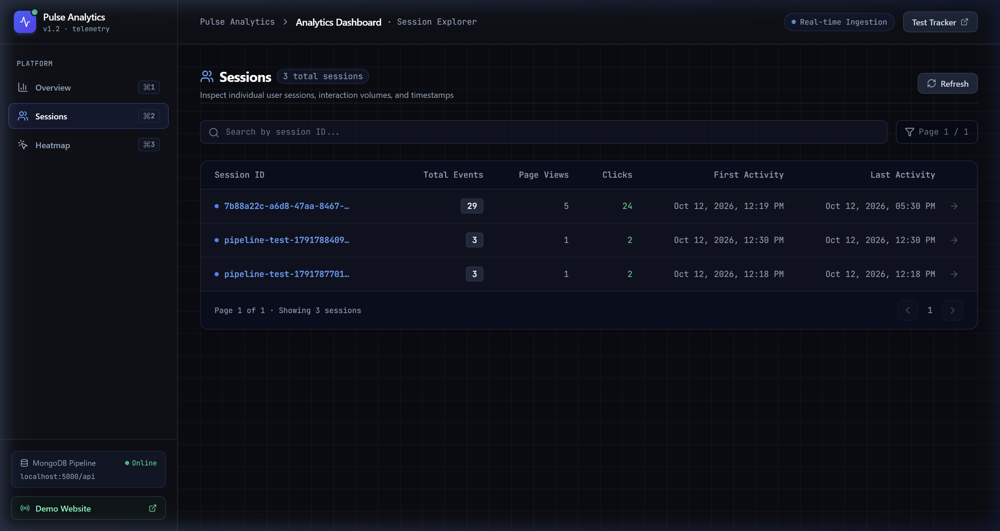
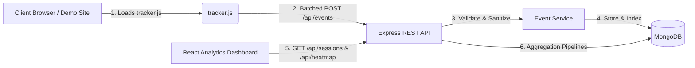

# Pulse Analytics — Full-Stack User Analytics Platform

Pulse Analytics is a lightweight, privacy-focused web analytics platform inspired by Google Analytics. It tracks browsing sessions, user interactions, and click coordinates using an embeddable, zero-dependency JavaScript tracking client, persisting events in MongoDB and visualizing metrics through a dashboard featuring session aggregations and click heatmaps.

---

## 1. Project Overview

Pulse Analytics provides end-to-end visibility into website traffic and interaction patterns:
- **Embeddable Tracking Script**: A lightweight client script (`tracker.js`) that captures `page_view` and `click` events without impacting host application performance.
- **RESTful API Backend**: An Express & TypeScript service providing validated ingestion endpoints, session rollups via MongoDB aggregation pipelines, and heatmap spatial queries.
- **Modern Analytics Dashboard**: A React, TypeScript, and Tailwind CSS web application displaying real-time metrics, interactive charts, session journeys, and page click heatmaps.
- **Interactive Demo Website**: A sample SaaS landing page instrumented with the tracking script to demonstrate natural event recording and pipeline verification.

### Interface Gallery

| Analytics Overview | Click Heatmap Visualizer |
|:---:|:---:|
|  |  |

| User Journey Trace | Session Explorer |
|:---:|:---:|
|  |  |

---

## 2. Features

- **Automated Page View Tracking**: Records URL, timestamp, and session ID on initial load and Single Page Application (SPA) navigation.
- **High-Precision Click Tracking**: Records document-relative coordinates (`pageX`, `pageY`) and viewport dimensions (`window.innerWidth`, `window.innerHeight`) for normalized canvas rendering.
- **Client Session Management**: Generates and persists unique session identifiers via `sessionStorage` across page views while isolating new tabs.
- **Resilient Event Batching & Beacon Flush**: Batches events periodically (every 2 seconds) or when 10 events accumulate; flushes cleanly via `navigator.sendBeacon` upon page unload.
- **Interactive Click Heatmap**: Overlays density heatmaps and coordinate plots over a page canvas with low/medium/high intensity gradient rendering.
- **Session Timelines & User Journeys**: Chronological visualization of all events within a session, including timestamps and click coordinates.
- **Automated Seed Data Generator**: Optional seed script for instant exploration with records marked `is_demo: true` for safe resets.

---

## 3. Tech Stack

### Frontend
- **Framework**: React 19 with Vite 8
- **Language**: TypeScript
- **Styling**: Tailwind CSS v4
- **Charts**: Recharts
- **Icons**: Lucide React
- **Routing**: React Router DOM v7
- **Testing**: Vitest with React Testing Library and JSDOM

### Backend
- **Runtime**: Node.js (v20+)
- **Framework**: Express.js
- **Language**: TypeScript
- **Validation**: express-validator
- **Security & Utilities**: Helmet, CORS, express-rate-limit, Morgan
- **Testing**: Jest, ts-jest, Supertest, MongoDB Memory Server

### Database
- **Database**: MongoDB (v7+)
- **ODM**: Mongoose (v8+)

---

## 4. Architecture Overview



---

## 5. Project Structure

```text
user-analytics-app/
├── client/                     # Frontend React + Vite application
│   ├── public/
│   │   └── tracker.js          # Reusable embeddable tracking client
│   ├── src/
│   │   ├── components/         # Reusable UI components (StatCard, Loading, Error, Empty)
│   │   ├── layouts/            # Dashboard layout with sidebar navigation
│   │   ├── pages/              # Overview, Sessions, SessionDetail, Heatmap, DemoPage
│   │   ├── services/           # Axios REST API client
│   │   ├── test/               # Vitest component & integration tests
│   │   ├── types/              # TypeScript interface definitions
│   │   └── utils/              # Date and number formatting utilities
│   ├── package.json
│   └── vite.config.ts
├── server/                     # Backend Express.js application
│   ├── src/
│   │   ├── config/             # Environment & MongoDB connection
│   │   ├── controllers/        # Request handlers (events, sessions, heatmap, health)
│   │   ├── middleware/         # Error handler, rate limiter, logger
│   │   ├── models/             # Mongoose Event schema and compound indexes
│   │   ├── routes/             # Express API routes
│   │   ├── services/           # Aggregation & database queries
│   │   ├── utils/              # Demo seed data script
│   │   ├── validators/         # express-validator schemas
│   │   ├── app.ts              # Express application setup
│   │   └── server.ts           # Server bootstrap
│   ├── tests/                  # Jest + Supertest integration tests
│   ├── package.json
│   └── tsconfig.json
├── docker-compose.yml          # Containerized MongoDB service
├── .env.example                # Template environment variables
├── package.json                # Root package for workspace orchestration
└── README.md
```

---

## 6. Prerequisites

- **Node.js**: v20.0.0 or later
- **npm**: v10.0.0 or later
- **MongoDB**: Local MongoDB instance running on port 27017 **OR** Docker Desktop

---

## 7. Installation Instructions

Clone the repository and install dependencies for both the frontend and backend:

```bash
# 1. Clone repository
git clone <repository-url>
cd CausalFunnel

# 2. Install backend dependencies
cd server
npm install

# 3. Install frontend dependencies
cd ../client
npm install

# 4. Return to root
cd ..
```

---

## 8. Environment Configuration

### Backend Configuration (`server/.env`)
Copy the example environment file:
```bash
cp .env.example server/.env
```
Default values:
```env
PORT=5000
NODE_ENV=development
MONGODB_URI=mongodb://localhost:27017/user_analytics
CLIENT_URL=http://localhost:5173
RATE_LIMIT_WINDOW_MS=60000
RATE_LIMIT_MAX_REQUESTS=100
```

### Frontend Configuration (`client/.env`)
```env
VITE_API_URL=http://localhost:5000/api
```

---

## 9. MongoDB Setup

You can run MongoDB locally or via Docker Compose:

### Option A: Using Docker Compose
```bash
docker-compose up -d
```

### Option B: Built-in MongoDB Runner (No Docker Required)
If you do not have Docker installed, you can start a local MongoDB instance immediately on port 27017:
```bash
npm run mongo
```

### Option C: System MongoDB Service
Ensure your local mongod service is running:
```bash
# macOS (Homebrew)
brew services start mongodb/brew/mongodb-community

# Linux (systemd)
sudo systemctl start mongod

# Windows
net start MongoDB
```

---

## 10. How to Run the Application

### Running Backend
```bash
cd server
npm run dev
```
The server will start at `http://localhost:5000`.

### Running Frontend
In a separate terminal:
```bash
cd client
npm run dev
```
The frontend will start at `http://localhost:5173`.

### Unified Execution (From Workspace Root)
```bash
# Start backend in watch mode
npm run server:dev

# Start frontend in dev mode
npm run client:dev
```

---

## 11. How to Use the Tracking Script

Embed the tracker into any website's HTML before the closing `</body>` tag:

```html
<!-- Embed Pulse Analytics Tracker -->
<script
  src="http://localhost:5173/tracker.js"
  data-api-url="http://localhost:5000/api"
  data-debug="true"
  defer
></script>
```

### Configuration Attributes
| Attribute | Description | Default |
|---|---|---|
| `src` | URL pointing to the hosted `tracker.js` | Required |
| `data-api-url` | Base URL of the Pulse Analytics REST API | `http://localhost:5000/api` |
| `data-debug` | When `"true"`, outputs logging to browser console | `false` |

### Programmatic API (`window.PulseTracker`)
The script exposes a non-intrusive global object:
```javascript
// Get current browsing session ID
const sessionId = window.PulseTracker.getSessionId();

// Manually trigger a page view
window.PulseTracker.trackPageView('https://example.com/custom-url');

// Manually track a custom click
window.PulseTracker.trackClick(x, y);

// Force-flush pending batched events
window.PulseTracker.flush();
```

---

## 12. Coordinate System for Heatmap Clicks

To guarantee that click positions render faithfully regardless of device resolution, scrolling, and screen sizes:

1. **Tracker Recording**:
   - Coordinates are captured relative to the document page using `e.pageX` and `e.pageY`.
   - The browser's active viewport dimensions (`window.innerWidth`, `window.innerHeight`) are recorded alongside each click event.
2. **Heatmap Normalization**:
   - The heatmap visualizer reads the original recorded coordinate `(click.x, click.y)` and viewport `(viewport.width, viewport.height)`.
   - Coordinates are normalized to canvas coordinates:
     $$\text{Canvas X} = \frac{\text{click.x}}{\text{viewport.width}} \times \text{Canvas Width}$$
     $$\text{Canvas Y} = \frac{\text{click.y}}{\text{viewport.height}} \times \text{Canvas Height}$$
   - This prevents clicks from shifting when viewed on displays of varying dimensions.

---

## 13. API Endpoint Documentation

| Method | Endpoint | Description | Query / Body Params |
|---|---|---|---|
| `POST` | `/api/events` | Ingest an analytics event | `{ session_id, event_type, page_url, timestamp, coordinates?, viewport? }` |
| `GET` | `/api/sessions` | Paginated session summaries | `?page=1&limit=20` |
| `GET` | `/api/sessions/:sessionId/events` | Chronological session events | `?page=1&limit=50` |
| `GET` | `/api/heatmap` | Click coordinates for a specific page | `?page_url=http://localhost:5173/demo&limit=1000` |
| `GET` | `/api/overview` | Dashboard summary metrics & charts | None |
| `GET` | `/api/pages` | List tracked pages with click counts | None |
| `GET` | `/api/health` | Server and database health status | None |

---

## 14. Example Event Payloads and API Responses

### Ingest Page View Event (`POST /api/events`)
**Request**:
```json
{
  "session_id": "8c593b48-12e7-4e6f-99a3-5c77740f937d",
  "event_type": "page_view",
  "page_url": "http://localhost:5173/demo",
  "timestamp": "2024-03-01T12:00:00.000Z"
}
```
**Response (201 Created)**:
```json
{
  "success": true,
  "data": {
    "_id": "65f02bc0b7842e12ab8931a2",
    "session_id": "8c593b48-12e7-4e6f-99a3-5c77740f937d",
    "event_type": "page_view",
    "page_url": "http://localhost:5173/demo",
    "timestamp": "2024-03-01T12:00:00.000Z"
  }
}
```

### Ingest Click Event (`POST /api/events`)
**Request**:
```json
{
  "session_id": "8c593b48-12e7-4e6f-99a3-5c77740f937d",
  "event_type": "click",
  "page_url": "http://localhost:5173/demo",
  "timestamp": "2024-03-01T12:01:15.000Z",
  "coordinates": {
    "x": 642,
    "y": 320
  },
  "viewport": {
    "width": 1440,
    "height": 900
  }
}
```
**Response (201 Created)**:
```json
{
  "success": true,
  "data": {
    "_id": "65f02bc0b7842e12ab8931a3",
    "session_id": "8c593b48-12e7-4e6f-99a3-5c77740f937d",
    "event_type": "click",
    "page_url": "http://localhost:5173/demo",
    "timestamp": "2024-03-01T12:01:15.000Z",
    "coordinates": { "x": 642, "y": 320 },
    "viewport": { "width": 1440, "height": 900 }
  }
}
```

### Sessions Summary Response (`GET /api/sessions`)
```json
{
  "success": true,
  "data": [
    {
      "session_id": "8c593b48-12e7-4e6f-99a3-5c77740f937d",
      "total_events": 8,
      "page_views": 3,
      "clicks": 5,
      "first_event_at": "2024-03-01T12:00:00.000Z",
      "last_event_at": "2024-03-01T12:04:32.000Z"
    }
  ],
  "meta": {
    "page": 1,
    "limit": 20,
    "total": 1,
    "totalPages": 1
  }
}
```

### Heatmap Data Response (`GET /api/heatmap?page_url=...`)
```json
{
  "success": true,
  "data": {
    "page_url": "http://localhost:5173/demo",
    "total_clicks": 5,
    "clicks": [
      {
        "x": 642,
        "y": 320,
        "viewport": { "width": 1440, "height": 900 }
      }
    ]
  }
}
```

---

## 15. Database Schema & Indexing Decisions

### Schema Structure (`Event`)
```typescript
{
  session_id: { type: String, required: true, maxlength: 128 },
  event_type: { type: String, required: true, enum: ['page_view', 'click'] },
  page_url: { type: String, required: true, maxlength: 2048 },
  timestamp: { type: Date, required: true },
  coordinates: {
    x: { type: Number, min: 0 },
    y: { type: Number, min: 0 }
  },
  viewport: {
    width: { type: Number, min: 1 },
    height: { type: Number, min: 1 }
  },
  is_demo: { type: Boolean, default: false }
}
```

### Indexing Decisions
- `{ session_id: 1, timestamp: 1 }`: Optimizes session journey retrieval (`GET /api/sessions/:sessionId/events`), which sorts events chronologically within a session.
- `{ page_url: 1, event_type: 1 }`: Powers heatmap queries (`GET /api/heatmap`), instantly filtering click events for a specific URL without table scans.
- `{ timestamp: -1 }`: Optimizes the overview query for recent activity trends.

---

## 16. How to Run Tests

### Run Backend Tests (Jest + Supertest + In-Memory MongoDB)
```bash
cd server
npm test
```
All 20 integration tests execute in an isolated in-memory MongoDB instance without affecting local databases.

### Run Frontend Tests (Vitest + React Testing Library)
```bash
cd client
npm test
```
Runs 24 tests verifying loading states, empty states, error states, table rendering, navigation, and heatmap rendering.

### Automated Pipeline Verification
With the server running, execute the full pipeline verification script:
```bash
npm run verify
```
This sends live HTTP requests (`page_view` and `click` with coordinates), checks MongoDB storage directly, validates session aggregation math, and confirms chronological order.

### Production Typecheck & Builds
```bash
# Backend build and typecheck
cd server
npm run typecheck
npm run build

# Frontend build and typecheck
cd ../client
npm run typecheck
npm run build
```

---

## 17. How to Generate Demo Activity & Test the Pipeline

1. **Launch Services**: Ensure both `server` (port 5000) and `client` (port 5173) are running.
2. **Open the Demo Website**: Navigate to `http://localhost:5173/demo`.
3. **Interact Naturally**:
   - Click navigation links, search bar, buttons, pricing cards, and testimonials.
   - Notice the green status bar showing the active Session ID and real-time click count incrementing.
4. **Use "Generate Demo Activity"**:
   - Click the blue **"Generate Demo Activity"** button in the demo header.
   - The script will dispatch realistic user click interactions across interactive elements on the page and automatically flush them to the server.
5. **View in Dashboard**:
   - Click **"Dashboard"** in the top-right of the demo page or navigate to `http://localhost:5173/`.
   - In **Overview**: Verify Total Sessions, Total Events, Page Views, and Total Clicks.
   - In **Sessions**: Click on your session ID to inspect the chronological user journey with coordinates.
   - In **Heatmap**: Select `http://localhost:5173/demo` from the dropdown to see the density heatmap and click dots rendered on the canvas preview.
6. **(Optional) Seed Realistic Multi-Session Data**:
   ```bash
   cd server
   npm run seed
   ```
   Generates 10 sessions across multiple URLs with authentic timestamps and clicks. All records are tagged `is_demo: true` and cleanly replaced on subsequent runs.

---

## 18. Known Limitations

- **Cross-Domain Heatmap Rendering**: Without an iframe proxy or full screenshot API, the heatmap visualizes clicks over a wireframe canvas of the page layout. For embedded customer domains, full HTML screenshot capture requires a headless browser worker service (e.g. Puppeteer).
- **Sub-domain Cookie Sharing**: Sessions are currently persisted in `sessionStorage` (per-tab/subdomain isolation). In multi-subdomain architectures, a shared root-domain cookie would allow session continuity across subdomains.

---

## 19. Technical Trade-offs

- **Single Document vs Bucket Architecture**: Events are modeled as individual MongoDB documents rather than pre-aggregated hourly buckets. This provides granular raw click coordinate retention and arbitrary time-slice filtering, at the cost of higher storage requirements.
- **Client-Side Batching vs Instant Delivery**: Batching every 2 seconds balances minimal HTTP overhead against immediate event arrival. Critical exit events use `navigator.sendBeacon` to eliminate data loss upon tab closing.

---

## 20. Future Improvements

- **IP Geolocation & Device Fingerprinting**: Enriching session ingestion with country/city and user-agent device parsing.
- **Scroll Depth Tracking**: Automatically capturing 25%, 50%, 75%, and 100% scroll milestones.
- **Funnel Conversion Analysis**: Multi-step conversion drop-off visualization between configurable page URLs.
